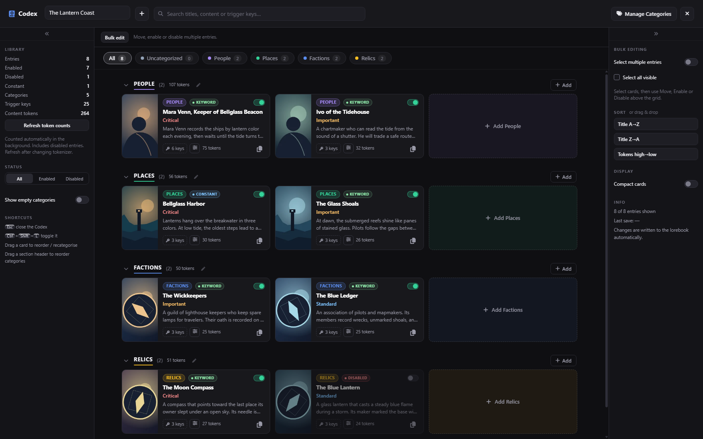
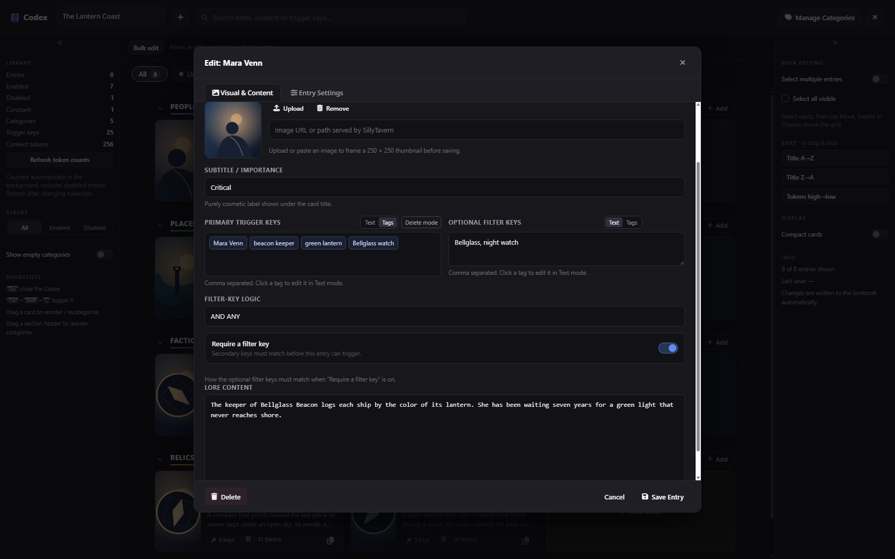
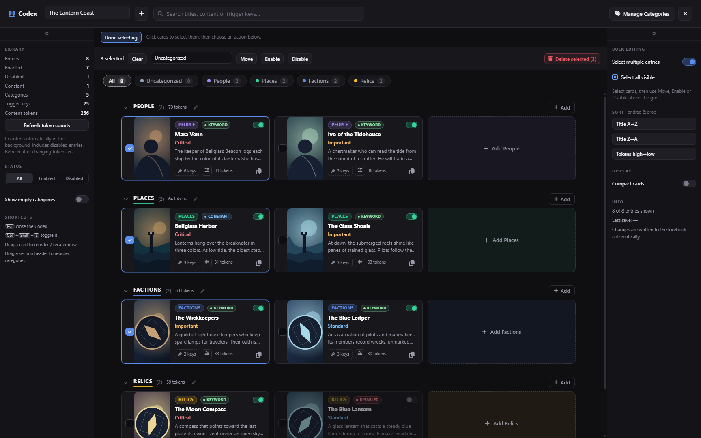

# Visual Lorebook

Visual Lorebook, also called **Codex**, gives SillyTavern’s lorebooks a full-screen card view. Browse your world at a glance, organize entries into colorful categories, and edit lore, keywords, and insertion settings in one place.



## Install

1. In SillyTavern, open **Extensions → Install Extension**.
2. Paste this repository URL:

   ```text
   https://github.com/Bekajoiy/st-visual-lorebook
   ```

3. Select **Install**. Open **Worlds/Lorebooks** and click **Codex** next to the heading.

You can also launch it from **Extensions → Visual Lorebook**, with the `/codex` command, or by pressing `Ctrl+Shift+L`. SillyTavern’s [extension installer guide](https://docs.sillytavern.app/extensions/#third-party-extensions) covers installation targets and prerequisites.

## What you can do

- **See the whole world.** Browse cards with thumbnails, content previews, activation states, keywords, and token counts. Hover or tap the key and settings buttons for details.
- **Make it yours.** Create color-coded categories, drag entries between them, and crop uploaded or pasted images into square thumbnails.
- **Edit in place.** Update lore text, work with keywords as text or tags, and adjust World Info settings in a two-tab editor.
- **Find and organize entries quickly.** Search, filter, sort, duplicate entries, and move, enable, disable, or delete selected cards in bulk.
- **Keep track of changes.** The editor prompts before discarding a draft and keeps it open if a save fails.

## Screenshots

The screenshots use **The Lantern Coast**, a fictional demo lorebook.

### Entry editor



### Bulk organization



## Compatibility

Tested with **SillyTavern 1.19.0**. Visual Lorebook uses native World Info and SillyTavern’s tokenizer. Optional direct opening from the native **Pick to Edit** selector is off by default. Enable it under **Extensions → Visual Lorebook / Codex**.

When editing the same lorebook across tabs or editors, finish one save before starting another. Simultaneous saves can overwrite each other.

## Development

Run the included store and data-preservation tests with Node.js 24 or later:

```sh
node --test tests/store.test.mjs
```


## License

[MIT](LICENSE)
