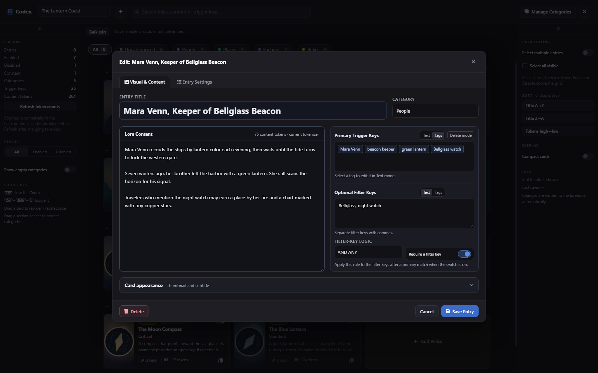
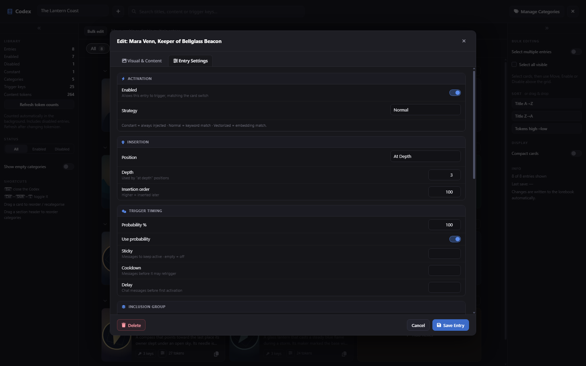
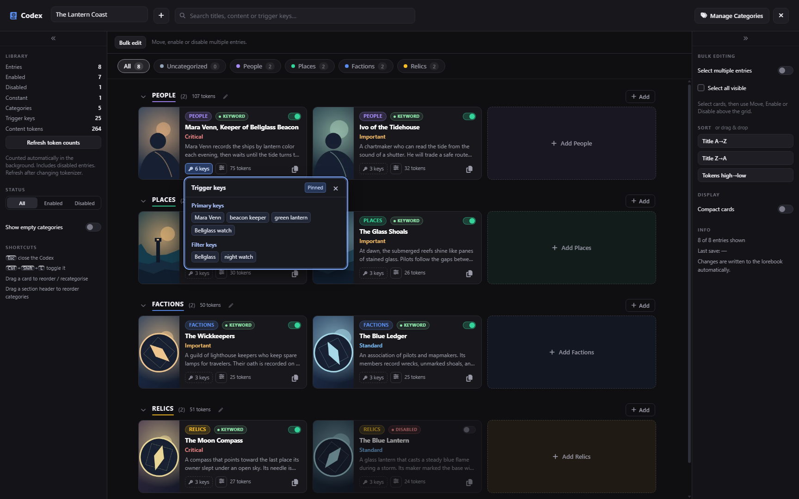
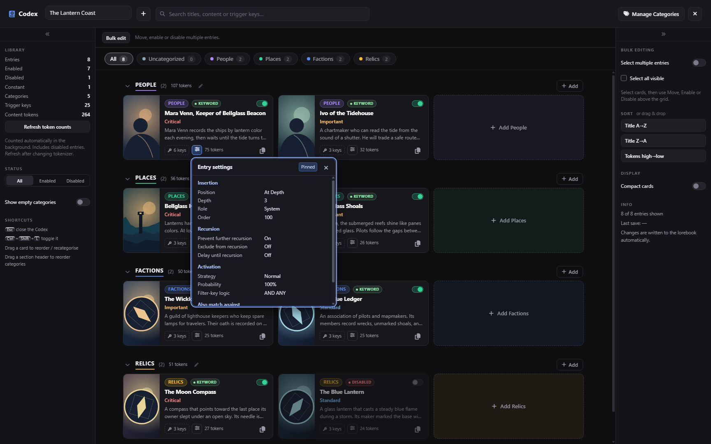
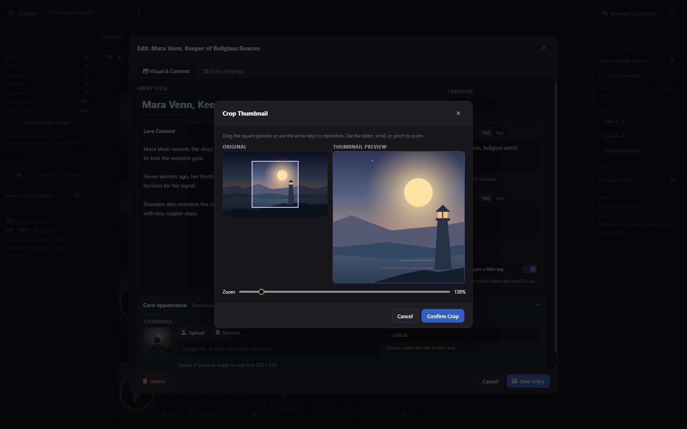

# Visual Lorebook / Codex

Give your SillyTavern lorebooks a full-screen card view. Browse your world at a glance, group related entries, and write lore with the content and trigger keys side by side.


## Works with your existing lorebooks

Install Codex and open the lorebooks you already use. They open directly in the native World Info format, with no conversion or manual migration.

Codex and SillyTavern’s built-in **World Info** editor work on the same books. You can use either editor, and SillyTavern continues to handle triggering and insertion. Categories, thumbnails, and other presentation choices live in a separate metadata section of the lorebook.

## Install

1. Open **Extensions → Install Extension** in SillyTavern.
2. Paste this Git repository URL.

   ```text
   https://github.com/Bekajoiy/st-visual-lorebook
   ```

3. Choose **Install** or **Install just for me** and confirm when prompted.
4. Open **Worlds/Lorebooks** and click **Codex** next to the heading. Pick a lorebook from the dashboard.

You can also open Codex from its section in the Extensions panel, with `/codex`, or by pressing `Ctrl+Shift+L`. See the [SillyTavern installation guide](https://docs.sillytavern.app/extensions/#third-party-extensions) for Git and installer prerequisites.

## What you can do

- **Browse and organize.** Scan illustrated cards, create color-coded categories, and drag entries into place. Search, filter, and sort to find what you need.
- **Write and edit.** Give entries a title, work with primary and optional keys in Text or Tags mode, and write in a dedicated lore area.
- **Inspect without opening an editor.** Preview keywords and entry settings from a card. Click or tap to pin a preview, and see token counts on entries and categories as you browse.
- **Work in batches.** Duplicate an entry, or move, enable, disable, and delete selected entries together.
- **Frame a thumbnail.** Reposition and zoom an uploaded or pasted image before saving its square crop.
- **Keep your draft.** Codex prompts before discarding changes and leaves an entry open when a save fails.

## Screenshots

All captures use **The Lantern Coast**, a fictional demo lorebook.

| Visual & Content editor | Entry Settings |
| --- | --- |
|  |  |

| Keyword preview | Entry settings preview |
| --- | --- |
|  |  |

### Thumbnail cropping



## Compatibility

Tested with **SillyTavern 1.19.0**. When using multiple tabs or editors, finish one save before starting another on the same lorebook. Simultaneous saves can still overwrite each other.

## Development

Run the portable data-preservation and cache tests with Node.js 24 or later.

```sh
node --test tests/store.test.mjs tests/native-cache.test.mjs
```

## License

[MIT](LICENSE)
